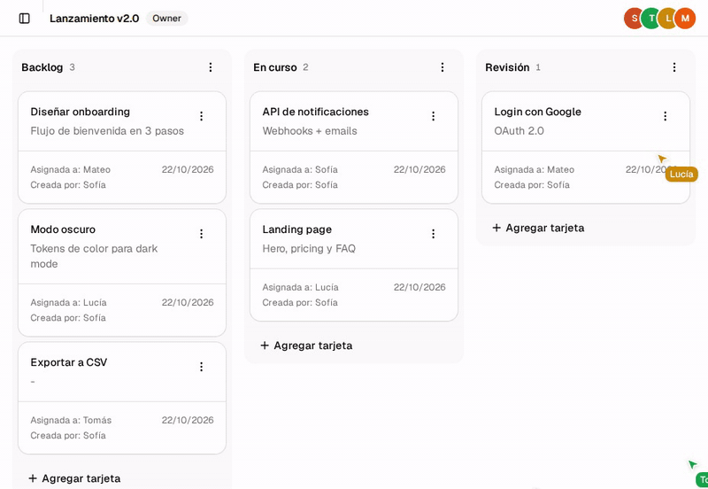

# BoardSync

[](https://github.com/JulianM432/BoardSync/actions/workflows/ci.yml)

Tablero kanban colaborativo con roles por board (owner, editor y viewer), drag & drop de tarjetas y cambios en tiempo real.



- `api/`: Express 5, Mongoose, Socket.IO y Zod.
- `app/`: React 19, Vite, TanStack Query y Router, shadcn/ui y dnd-kit.

## Testing

La suite e2e usa [Playwright](https://playwright.dev) y corre contra un entorno aislado: un MongoDB en Docker, sin tocar la base de desarrollo, y su propia API y app en puertos aparte (`5001` y `5174`). Así puede correr con los servidores de desarrollo levantados.

```bash
cd app
pnpm test:e2e          # levanta Mongo, siembra los usuarios y corre toda la suite
pnpm test:e2e:ui       # modo UI de Playwright, para ver los tests paso a paso
pnpm test:e2e:report   # abre el último reporte HTML
pnpm e2e:db:down       # apaga el contenedor de Mongo
```

Requisitos: Docker y las dependencias instaladas en `api/` y `app/`. La primera vez también hay que instalar el navegador con `pnpm exec playwright install chromium`.

### Cómo está armada

| Pieza | Qué hace |
|---|---|
| `e2e/compose.yml` | MongoDB efímero (`tmpfs`) en el puerto `27018` |
| `api/src/scripts/seed-e2e.ts` | Vacía la base y crea los usuarios de prueba. Se niega a correr si la base no termina en `_e2e` |
| `e2e/setup/` | Proyecto `setup`: loguea a cada usuario una vez y guarda la sesión (`storageState`) |
| `e2e/fixtures/` | Fixtures `apiAs`, `pageAs` y `board` (crea un board por test y lo borra al terminar); `realtime.ts` agrega `liveBoardAs` y `socketAs` |
| `e2e/pages/` | Page objects (`BoardPage`, `AppShell`, `LoginPage`) |
| `e2e/api/` | Proyecto `api`: tests de la API sin navegador (validaciones y permisos por rol) |
| `e2e/ui/` | Proyecto `chromium`: flujos de usuario, drag & drop, tiempo real y presencia |

Cada test crea sus propios datos, por eso la suite corre en paralelo. En CI (GitHub Actions) se ejecutan lint, build y la suite e2e en cada push y PR, y el reporte de Playwright queda como artefacto.
